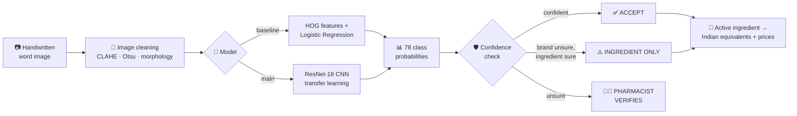
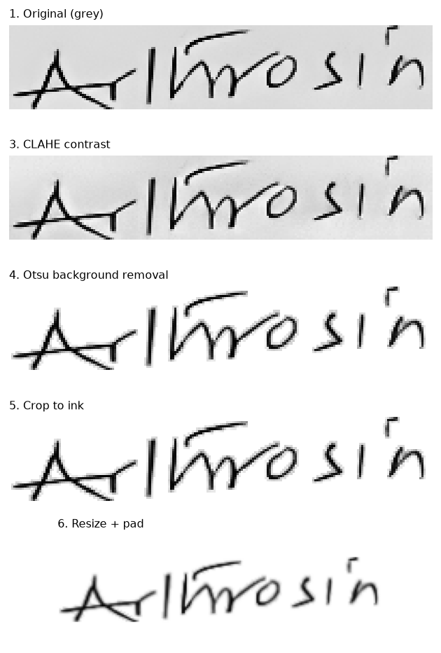
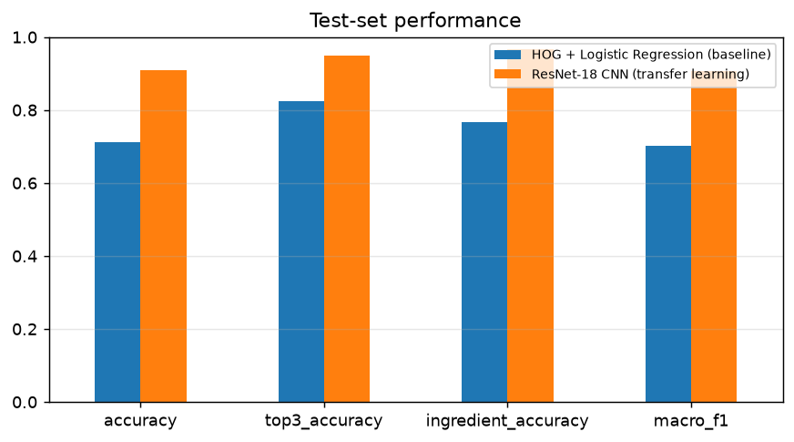
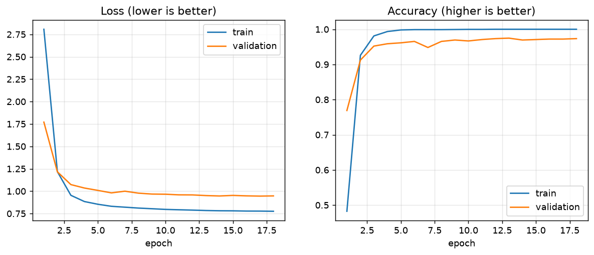
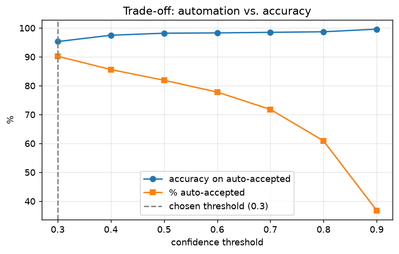
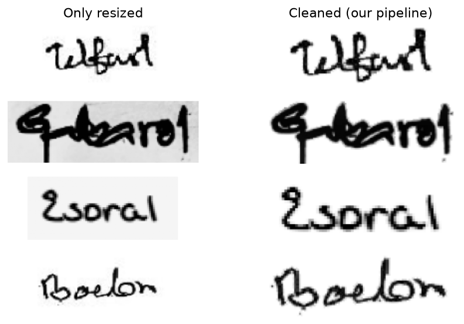

<div align="center">

# 💊 MedScript

### Digitizing Handwritten Prescriptions with Image Processing & Deep Learning

*Reads a doctor's handwritten medicine name, knows when it's unsure, and finds the Indian equivalents.*

<br>


<br>

| 🎯 **91.0%** | 💊 **96.6%** | 📈 **+20 pts** | 🧪 **758** |
|:---:|:---:|:---:|:---:|
| test accuracy (brand) | correct active ingredient | CNN over classic-ML baseline | unseen test images |

</div>

---

## 📌 Table of contents

- [The problem](#-the-problem)
- [What MedScript does](#-what-medscript-does)
- [How it works](#%EF%B8%8F-how-it-works)
- [Results](#-results)
- [Key findings](#-key-findings)
- [Quick start](#-quick-start)
- [Project structure](#-project-structure)
- [Limitations & future work](#%EF%B8%8F-limitations--future-work)

---

## 🩺 The problem

Many prescriptions in India are still **handwritten**, and doctors' handwriting is famously hard to read.

- **Patient safety:** a misread medicine name can mean the wrong drug.
- **Lost data:** handwritten prescriptions never become structured data, so pharmacies, hospitals and healthcare analytics teams can't use them.

MedScript turns a handwritten medicine name into **reliable, structured information**, and it is honest about when a human needs to check.

---

## ✨ What MedScript does

<table>
<tr>
<td width="33%" valign="top">

### 🔍 Reads
Recognises the handwritten medicine name with a **fine-tuned ResNet-18 CNN**, and shows the top-3 guesses with confidence scores.

</td>
<td width="33%" valign="top">

### 🛡️ Knows when it's unsure
A **human-in-the-loop** check auto-accepts confident predictions and sends uncertain ones to a pharmacist.

</td>
<td width="33%" valign="top">

### 🇮🇳 Maps to India
Finds the **active ingredient** and lists Indian medicines with the same ingredient and form, **cheapest first**, from a 254k-medicine database.

</td>
</tr>
</table>

**Bonus:** a fuzzy **"search by text"** feature. Type a misspelling like `Montiar` and it finds `Montair`.

---

## ⚙️ How it works



### 1️⃣ Image processing (the ECE part)

| Step | Technique | Why |
|---|---|---|
| Grayscale | colour → 1 channel | colour carries no information about the word |
| Contrast | **CLAHE** (adaptive histogram equalisation) | fixes faint ink and uneven lighting, tile by tile |
| Background removal | **Otsu thresholding** + 1-px **dilation** of the ink mask | whitens the paper and keeps thin, soft stroke edges |
| Crop | bounding box of the ink | the word fills the frame |
| Resize + pad | keep aspect ratio (≈1:3) | no squashed letters |

<p align="center">
  
</p>

### 2️⃣ Two models: a baseline, then the real thing

| | Baseline | Main model |
|---|---|---|
| **Features** | HOG (hand-designed edge-direction histograms) | learned by the network |
| **Classifier** | Logistic Regression | ResNet-18 (18-layer CNN with skip connections) |
| **Knowledge** | trained from scratch | **pretrained on ImageNet** (1.2M images), fine-tuned |
| **Tuning** | grid search over C and HOG cell size on validation | early stopping on validation, cosine LR schedule |
| **Anti-overfitting** | L2 regularisation | augmentation (rotate, shift, shear, pen thickness), label smoothing, weight decay |

### 3️⃣ Honest evaluation

- 🔒 **Train / validation / test discipline.** The model learns on train, decisions are made on validation, and the test set is used **once**.
- 🚫 **Leakage removed.** 22 test and 27 validation images were byte-identical copies of training images (found with MD5 hashes) and were dropped.
- 💊 **Patient-safety metric.** Besides brand accuracy, we measure whether the **active ingredient** is right.

---

## 📊 Results

### Model comparison: test set (758 unseen images)

| Model | Accuracy | Top-3 accuracy | Correct ingredient | Macro F1 |
|---|:---:|:---:|:---:|:---:|
| HOG + Logistic Regression | 71.1% | 82.3% | 76.6% | 0.703 |
| 🏆 **ResNet-18 CNN** | **91.0%** | **95.0%** | **96.6%** | **0.907** |

<p align="center">
  
</p>

### Training curves

Best validation accuracy of **97.5% at epoch 13**. Early stopping ended training at epoch 18. Validation loss kept trending down apart from small blips at epochs 7 and 15, so there was no sign of overfitting even with 100% training accuracy. About 33 s per epoch on an Apple-silicon GPU (MPS).

<p align="center">
  
</p>

### Human-in-the-loop: automation vs. safety

| Confidence threshold | Auto-accepted | Accuracy on accepted | Sent to pharmacist | Mistakes caught |
|:---:|:---:|:---:|:---:|:---:|
| 0.3 *(chosen on validation)* | 90.2% | 95.3% | 9.8% | 52.9% |
| 0.6 | 77.8% | 98.3% | 22.2% | 85.3% |
| 0.8 | 60.9% | 98.7% | 39.1% | 91.2% |

> 💡 The threshold is a **business decision**. A hospital that values speed picks 0.3; one that values safety picks 0.6 or higher. Set it in `src/config.py`, or with the slider in the app.

<p align="center">
  
</p>

---

## 🔬 Key findings

<details open>
<summary><b>1. Measuring each image-processing step beat following the textbook (+12 points)</b></summary>
<br>

Validation accuracy of the baseline under different preprocessing:

| Preprocessing | Val. accuracy |
|---|:---:|
| Only resize | 67.6% |
| Textbook: median filter + hard Otsu | 72.1% |
| No median filter + hard Otsu | 77.3% |
| **Final: no median filter + dilated Otsu mask** | **80.0%** |

The median filter *hurt*: at this resolution pen strokes are only 1–3 px wide, and a 3×3 median erased parts of them.

<p align="center">
  
</p>
</details>

<details open>
<summary><b>2. When the CNN is wrong, it's usually wrong safely</b></summary>
<br>

Almost every confused pair is between brands of the **same drug**:

| True | Predicted as | Same ingredient? |
|---|---|:---:|
| Montene / Montex / Monas | Montair / Provair | ✅ montelukast |
| Sergel | Maxpro / Esoral | ✅ esomeprazole |
| Maxima | Nexum | ✅ esomeprazole |
| Renova | Dancel | ❌ |

That's why **ingredient accuracy (96.6%) is well above brand accuracy (91.0%)**.

*Open question:* some confused names don't look alike (Sergel vs Maxpro). Brands of the same drug may come from similar prescriptions or writers, so the model may be partly using handwriting style. This is worth testing with writer-level splits.
</details>

<details>
<summary><b>3. Validation scores were optimistic, so test scores are reported</b></summary>
<br>

Validation images are measurably closer to the training images than test images are (median pixel distance 12.1 vs 13.5), probably because they share writers. That's why validation accuracy (97.5%) is higher than test accuracy (91.0%). **Only test numbers are reported as results.**
</details>

<details>
<summary><b>4. Learned features vs hand-designed features</b></summary>
<br>

| Approach | Val. accuracy |
|---|:---:|
| Raw pixels + Logistic Regression | 56% |
| HOG + Logistic Regression | 80% |
| ResNet-18 CNN (end to end) | 97.5% |
</details>

---

## 🚀 Quick start

### 1. Install

```bash
git clone <your-repo-url> medscript && cd medscript
python3 -m venv venv
source venv/bin/activate          # Windows: venv\Scripts\activate
pip install -r requirements.txt
```

### 2. Get the data

Download both datasets from Kaggle and place them in **`data/raw/`**:

| Dataset | Put it here | Name it |
|---|---|---|
| [Doctor's Handwritten Prescription BD](https://www.kaggle.com/datasets/mamun1113/doctors-handwritten-prescription-bd-dataset) | `data/raw/` | rename the folder to **`handwriting`** |
| [A-Z Medicine Dataset of India](https://www.kaggle.com/datasets/shudhanshusingh/az-medicine-dataset-of-india) | `data/raw/` | keep **`A_Z_medicines_dataset_of_India.csv`** |

```
data/raw/
├── handwriting/
│   ├── Training/     training_labels.csv + training_words/   (3,120 images)
│   ├── Validation/   validation_labels.csv + validation_words/ (780)
│   └── Testing/      testing_labels.csv + testing_words/     (780)
└── A_Z_medicines_dataset_of_India.csv                       (~32 MB)
```

### 3. Run the pipeline

```bash
python -m src.eda              # explore the data            (~1 min)
python -m src.train_baseline   # HOG + Logistic Regression    (~3 min)
python -m src.train_cnn        # ResNet-18 fine-tuning        (~10 min on GPU / Apple MPS)
python -m src.evaluate         # final test-set evaluation    (~1 min)
streamlit run app.py           # launch the web app → http://localhost:8501
```

<details>
<summary><b>📋 Which data does each step use?</b></summary>
<br>

| Step | Training | Validation | Testing | Medicine DB | Output |
|---|:---:|:---:|:---:|:---:|---|
| `eda` | 👀 | 👀 | 👀 | | `reports/figures/eda_*` |
| `train_baseline` | **learns** | **tunes** | | | `models/baseline.joblib` |
| `train_cnn` | **learns** | **picks best epoch** | | | `models/cnn.pt` |
| `evaluate` | | picks threshold | **final score** | | `reports/*.csv`, figures |
| `app.py` | | | demo images | **equivalents & prices** | web app |

</details>

<details>
<summary><b>☁️ No GPU? Train on Google Colab</b></summary>
<br>

1. Zip the `medscript` folder (including `data/raw/`) and upload it to Google Drive.
2. In Colab: *Runtime → Change runtime type → T4 GPU*.
3. Run:
   ```python
   from google.colab import drive; drive.mount('/content/drive')
   !unzip -q /content/drive/MyDrive/medscript.zip -d /content/
   %cd /content/medscript
   !python -m src.train_cnn
   !python -m src.evaluate
   ```
4. Download `models/cnn.pt` and `reports/` back into your local project.
</details>

<details>
<summary><b>🛠️ Troubleshooting</b></summary>
<br>

| Problem | Fix |
|---|---|
| `No module named 'src'` | Run from inside `medscript/`, using `python -m src.xxx` |
| `Could not find the handwriting dataset` | `data/raw/handwriting/Training/` must exist |
| `Indian medicine database is missing or empty` | Re-extract the CSV; it should be ~32 MB |
| Baseline won't load (version error) | Re-run `python -m src.train_baseline` |
| CNN can't download weights | The first run needs internet (~45 MB of ImageNet weights) |
</details>

---

## 🗂️ Project structure

```
medscript/
├── app.py                  🖥️  Streamlit web app
├── requirements.txt
├── src/
│   ├── config.py           ⚙️  all paths & settings in one place
│   ├── data_loader.py      📂  loads splits, removes leaked duplicates
│   ├── preprocessing.py    🧹  image-processing pipeline
│   ├── eda.py              🔎  exploratory data analysis
│   ├── features.py         📐  HOG features
│   ├── train_baseline.py   📉  classic-ML baseline + ablation study
│   ├── cnn_model.py        🧠  ResNet-18, shared by training & app
│   ├── train_cnn.py        🏋️  transfer-learning training loop
│   ├── predictor.py        🔌  one interface for both models
│   ├── evaluate.py         📊  test metrics, confusion, thresholds
│   └── correction.py       🛡️  confidence check, Indian equivalents, fuzzy search
├── models/                 💾  saved models (created by training)
└── reports/                📈  result tables + figures (created by scripts)
```

**Design choices**
- **Single source of preprocessing:** training and the app call the same functions, which prevents training/serving skew.
- **Common predictor interface:** the app runs with either model, and falls back to the baseline if no CNN is trained.
- **Config in one file:** image sizes, epochs and threshold are all in `src/config.py`.

---

## ⚠️ Limitations & future work

| Limitation | Next step |
|---|---|
| Closed vocabulary of 78 brands | Open-vocabulary handwriting recognition (TrOCR, CRNN + CTC) |
| Word images are pre-cropped | Word detection on full prescription pages |
| Data from Bangladesh | Collect Indian prescriptions (with consent) |
| Possibly few writers; possible style shortcut | Writer-independent train/test splits |
| Drug strength (mg) and dosage ("1-0-1") not read | Parse strength and dosage patterns |
| Confidence not formally calibrated | Temperature scaling, reliability diagrams |

> 🩺 **MedScript is an assistive tool, not a medical device.** A qualified pharmacist makes the final decision.

---

## 📚 Data & credits

- **Handwriting data:** [Doctor's Handwritten Prescription BD dataset](https://www.kaggle.com/datasets/mamun1113/doctors-handwritten-prescription-bd-dataset) (Kaggle): 4,680 word images, 78 brands, 15 active ingredients.
- **Medicine database:** [A-Z Medicine Dataset of India](https://www.kaggle.com/datasets/shudhanshusingh/az-medicine-dataset-of-india) (Kaggle): about 254k medicines with compositions and prices.
- **Pretrained model:** ResNet-18 ([He et al., 2015](https://arxiv.org/abs/1512.03385)) with ImageNet weights from [torchvision](https://pytorch.org/vision/stable/models.html).

---

<div align="center">

**Built by Shreya Khandelwal** · B.Tech ECE, 4th year

*Where signal processing meets machine learning, for safer prescriptions.*

</div>
